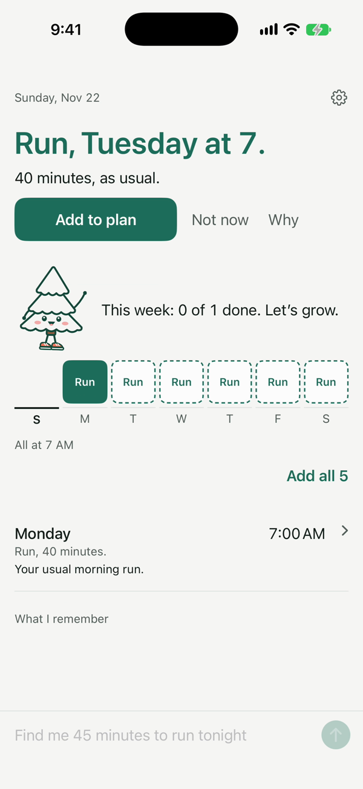
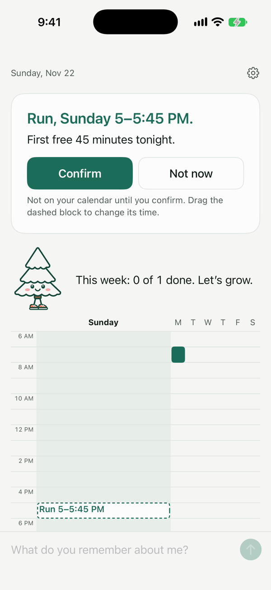
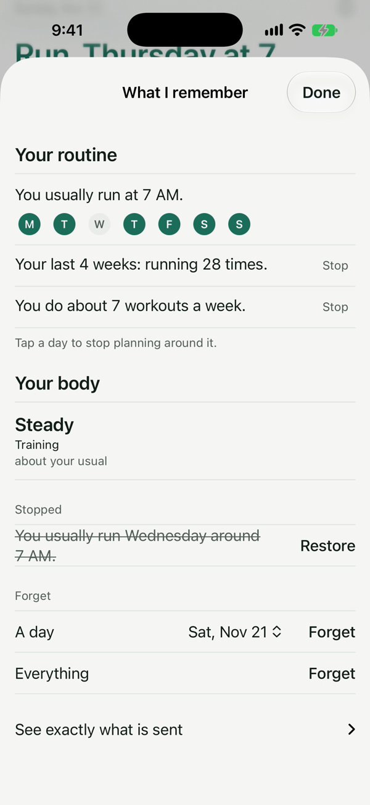
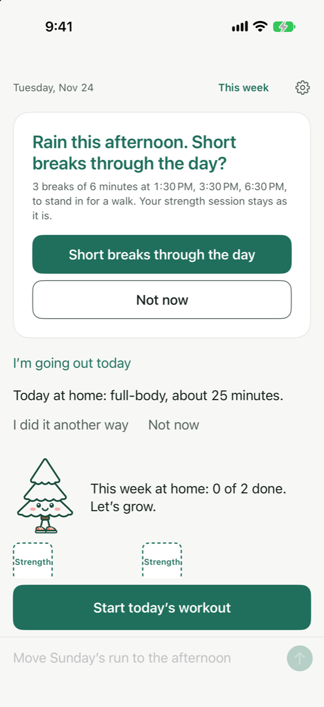
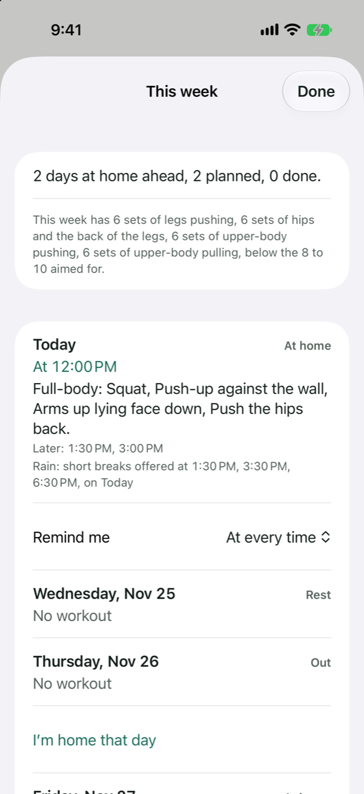
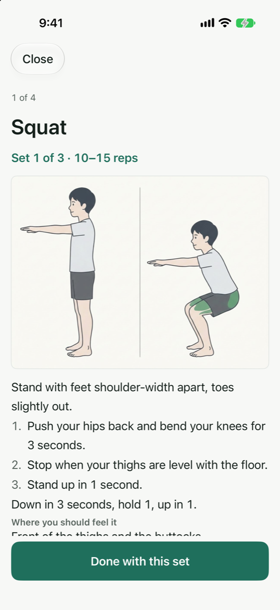

# Evergreen

An iPhone app that plans your workouts around your real week and keeps them there.

It reads your workouts and sleep from Apple Health and your free time from your calendar, suggests the week's sessions with the reason for each one, and puts on your calendar only what you add. When a meeting lands on a workout it moves the workout. When rain is due it asks whether to move or go indoors. When you say "not now", it stops planning around that habit.

This continues the app our team built at the Personal Agents Hackathon in November 2026. It now runs entirely on the phone with your own AI key.

<p>
  
  
  
  
</p>

Training at home by your own rules:

<p>
  
  
  
</p>

[Watch a two-minute walkthrough](docs/demo.mp4) (recorded in the simulator with sample data; the second half is a day at home: Today, the week, and the first sets of a workout).

[](marketing/final/it-finds-the-time.mp4)

[Watch the promo film, "It finds the time"](marketing/final/it-finds-the-time.mp4) (63 seconds). How it was made, with every prompt and take, is in [marketing](marketing/README.md).

[Watch the short film, "Don't give it back"](marketing/dont-give-it-back/final/dont-give-it-back.mp4) (30 seconds, 1080p): a photoreal period short about practising instead of wishing. How it was made is in [its README](marketing/dont-give-it-back/README.md).

## What you can do with it

- **See your week before it happens.** Today opens with the next thing worth doing and why, above a picture of your week.
- **Add or decline in one tap.** Add a session and it goes on your calendar; decline it and that habit is no longer planned around.
- **Ask in a sentence.** "Find me 45 minutes to run tonight." "Move Sunday's run to the afternoon." "What do you remember about me?"
- **See what it remembers.** A short list built once a day from your data. Stop any line, or forget a day or everything.
- **Set your own rules.** Settings, then My rules: your rest days, the hours you can train, how long a session may be, what equipment you have and any movement to avoid. Each day of the week is then at home, out or rest, from your rules and your calendar, and "I’m going out today" on Today changes a day in one tap.
- **Train at home without thinking about it.** On a day at home Today shows the session and "Start" opens a workout page: each movement in words and in a picture of its start and end, its sets and reps, a rest countdown, and "Too hard", "Swap" and "Skip". The first session with a backpack movement finds its weight, said as litres of water: there "Too hard" takes off 1 kg and "Too easy" adds 2 kg; after that "Too easy" is gone and the weight goes up by itself. Offline the page says so and works the same. Finishing it saves a strength workout to Apple Health; if Health can't take it, the app keeps it so it still counts.
- **Sessions that grow with you.** A session holds 4 to 5 movements and never runs past its length (25 minutes, or the longest you set). The week aims for 8 to 10 sets for each of the four main movement patterns (legs pushing, hips and the back of the legs, upper-body pushing, upper-body pulling), never more than 10. A movement moves on in steps: more reps, then slower (2 seconds longer on the way down), then 1 kg more in a backpack (up to 12 kg), then the harder movement, which doesn't wait for 12 kg. A movement you can't do yet is replaced by the easier one in its chain until you say you can, and "Swap" only offers movements open to you. After four full weeks the fifth is lighter, one set fewer of everything, and the count starts again.
- **See the whole week as a table.** The plan is kept day by day and moves when a day is missed. It is worked out again the first time the app opens each day, when your calendar changes, and on Sunday evening for the week ahead (a phone locked then catches up as soon as it is unlocked). The week table shows each day's kind, time, later times and movements. Offline it says so and still shows the week worked out on the phone, and it reloads by itself once you are back online; when the week can't be worked out it offers "Try again".
- **Get reminded until it's done.** On a day at home: the evening before, before the session, at its time and at each later time. Every notification the app sends shares a limit of six a day, and none comes from 22:00 until 09:00 (or until your own earlier start, if your hours begin before 9). If the first time passes without a start, 20 minutes later a reminder says it moved to the next time, and the session on your plan and calendar moves there by itself. Pick any one of the day's times in the week table or the evening notification instead, and only that time reminds, 10 minutes before and at the time; then nothing moves by itself, and 20 minutes after it one notification asks whether to move to a later time. "Always ask me to pick one time" keeps only the time you pick each day. The last reminder of the day has Start, Already done, "Skip today: I'm out" and "Skip today: not feeling well"; once the session is done, the rest of that day's reminders stop.
- **Short breaks when rain keeps you in.** Rain through the afternoon of a day at home brings an offer of two or three six-minute breaks, spread out and clear of your calendar.
- **Earn screen time by working out.** Pick the social, video and game apps to lock in Settings, then Earned screen time. Each group has free time every day (60 minutes of social apps, 30 of videos, 30 of games), used first and not carried over. After that, every workout minute earns more at a rate you set (2 minutes of social apps, 1 of videos and half a minute of games by default). Turning it on first shows every app it will lock and asks "Lock these apps?". Open a locked app and use the time, up to 15 minutes at a time; it locks again when the time is up. Once a week, with nothing left, "Unlock for 10 minutes" opens it anyway, and the day you train after a missed day adds 15 minutes to each group.

## What you need

- A Mac with Xcode (tested with Xcode 27.2) and an iPhone simulator. The app runs on iOS 18 or later.
- Node.js 20 or newer, only to run the engines' tests.
- For Earned screen time, an iPhone: Apple's Screen Time locks run only on a device. To run on a phone, follow the signing step in [the app's README](app/README.md#run-it).
- A Gemini API key from [Google AI Studio](https://aistudio.google.com/apikey). The app uses `gemini-3.8-flash`; you pay Google for what you use.

## Run it

1. Get the code: `git clone https://github.com/tony-workbench/Evergreen.git` and `cd Evergreen`.
2. Open `app/Evergreen.xcodeproj` in Xcode.
3. Choose an iPhone simulator at the top of the window and press Run.
4. In the app, go through the short tour and allow Calendar, Health, Notifications and Screen Time (Screen Time is only for Earned screen time; saying no to any of them never blocks the app).
5. On "Connect your AI", paste your Gemini key and press "Check connection & save".
6. Today shows your first suggestions. Tap "Add to plan" on one, or tap a dashed block in the week.

A simulator has no workouts in Apple Health, so the app starts with two general suggestions and says it needs about two weeks of your workouts to learn your routine. To see it with a month of made-up runs instead:

```sh
xcrun simctl launch booted com.evergreentraining.app -uiTest runner
```

## Test it

```sh
xcodebuild test -project app/Evergreen.xcodeproj -scheme Evergreen \
  -destination 'platform=iOS Simulator,name=iPhone 17' CODE_SIGNING_ALLOWED=NO
```

This runs both test targets: `EvergreenTests` (unit and flow tests, no network) and `EvergreenUITests` (on the `-uiTest home` seed: start a session, do every set and finish, "Too hard", skip today and take it back, pick a time in the week table, My rules saying what is wrong at once, every permission row, a reminder opening today's workout page or another day's week, the week offline and then online, and Reduce Motion; plus accessibility audits in light and dark and at the largest text size). Add `-only-testing:EvergreenTests` or `-only-testing:EvergreenUITests` to run one of them.

The engines have their own tests, with Node.js 20 or newer:

```sh
(cd recommend-agent && npm install && npm test && npm run eval:home)
(cd memory-agent && npm install && npm test)
(cd calendar-planner && npm install && npm test)
(cd contract && npm test && npm run check)
```

`npm run eval:home` grades 30 home weeks: the engine before this change, each change on its own, and the engine now, one comparison per change against a baseline recorded from the earlier engine (see `recommend-agent/docs/HOME.md`). `contract` runs the three committed bundles together, and `npm run check` lists their globals and checks what they return.

## What leaves your phone

- To Google's Gemini API, with your key: the sentence you type, a short table of facts about your training (counts, times, averages), and, with My rules on, the limits from your rules, which of the coming days are at home, out or rest, and the movements open to you on each day at home (from the app's own library) so the AI can choose them; code checks every choice before you see it, and the workout page marks it as picked by AI. Never raw health readings (only sleep and resting heart rate as 7- and 28-day averages), names, calendar event titles or places.
- To Apple's geocoder, when you have set a home in My rules: the typed place of a calendar event that has no map location, to tell whether the day is at home. A place found is kept on the phone, so it is sent once and still known offline; offline, a place never found counts as not home. Event titles never leave.
- To Open-Meteo, when rain check is on: your location rounded to about a kilometre, to fetch the forecast.
- To Apple Maps, when rain is due on an outdoor workout: the same rounded location and the word "gym", to find indoor places nearby.

Nothing else. There is no Evergreen server.

## More

- [How it works](docs/ARCHITECTURE.md)
- [How the agents connect](contract/AGENTS.md)
- [The design](DESIGN.md)
- [The app's code](app/README.md)
- [The rules for a week at home](recommend-agent/docs/HOME.md)
- [What changed](CHANGELOG.md)
