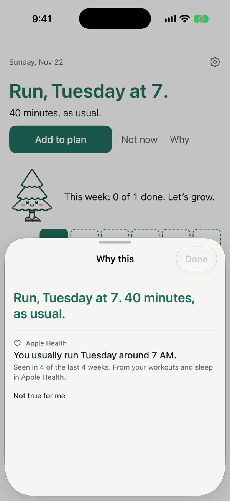

# Evergreen

An iPhone app that plans your workouts around your real week and keeps them there.

It reads your workouts and sleep from Apple Health and your free time from your calendar, suggests the week's sessions with the reason for each one, and puts on your calendar only what you add. When a meeting lands on a workout it moves the workout. When rain is due it asks whether to move or go indoors. When you say "not now", it stops planning around that habit.

This continues the app our team built at the Personal Agents Hackathon in November 2026. It now runs entirely on the phone with your own AI key.

<p>
  
  
  
  
</p>

[Watch a one-minute walkthrough](docs/demo.mp4) (recorded in the simulator with sample data).

[](marketing/final/it-finds-the-time.mp4)

[Watch the promo film, "It finds the time"](marketing/final/it-finds-the-time.mp4) (63 seconds). How it was made, with every prompt and take, is in [marketing](marketing/README.md).

## What you can do with it

- **See your week before it happens.** Today opens with the next thing worth doing and why, above a picture of your week.
- **Add or decline in one tap.** Add a session and it goes on your calendar; decline it and that habit is no longer planned around.
- **Ask in a sentence.** "Find me 45 minutes to run tonight." "Move Sunday's run to the afternoon." "What do you remember about me?"
- **See what it remembers.** A short list built once a day from your data. Stop any line, or forget a day or everything.

## What you need

- A Mac with Xcode (tested with Xcode 27.2) and an iPhone simulator.
- A Gemini API key from [Google AI Studio](https://aistudio.google.com/apikey). The app uses `gemini-3.8-flash`; you pay Google for what you use.

## Run it

1. Get the code: `git clone https://github.com/tony-workbench/Evergreen.git` and `cd Evergreen`.
2. Open `app/Evergreen.xcodeproj` in Xcode.
3. Choose an iPhone simulator at the top of the window and press Run.
4. In the app, go through the short tour and allow Calendar, Health and Notifications.
5. On "Connect your AI", paste your Gemini key and press "Check connection & save".
6. Today shows your first suggestions. Tap "Add to plan" on one, or tap a dashed block in the week.

A simulator has no workouts in Apple Health, so the app starts with two general suggestions and says it needs about two weeks of your workouts to learn your routine. To see it with a month of made-up runs instead:

```sh
xcrun simctl launch booted com.evergreentraining.app -uiTest runner
```

## Test it

```sh
xcodebuild test -project app/Evergreen.xcodeproj -scheme Evergreen \
  -destination 'platform=iOS Simulator,name=iPhone 17' CODE_SIGNING_ALLOWED=NO
```

The three engines have their own tests: run `npm install && npm test` in `memory-agent`, `recommend-agent` and `calendar-planner`, then in `contract` to run them together.

## What leaves your phone

- To Google's Gemini API, with your key: the sentence you type, and a short table of facts about your training (counts, times, averages). Never raw health readings, names or calendar event titles.
- To Open-Meteo, when rain check is on: your location rounded to about a kilometre, to fetch the forecast.

Nothing else. There is no Evergreen server.

## More

- [How it works](docs/ARCHITECTURE.md)
- [How the agents connect](contract/AGENTS.md)
- [The design](DESIGN.md)
- [The app's code](app/README.md)
