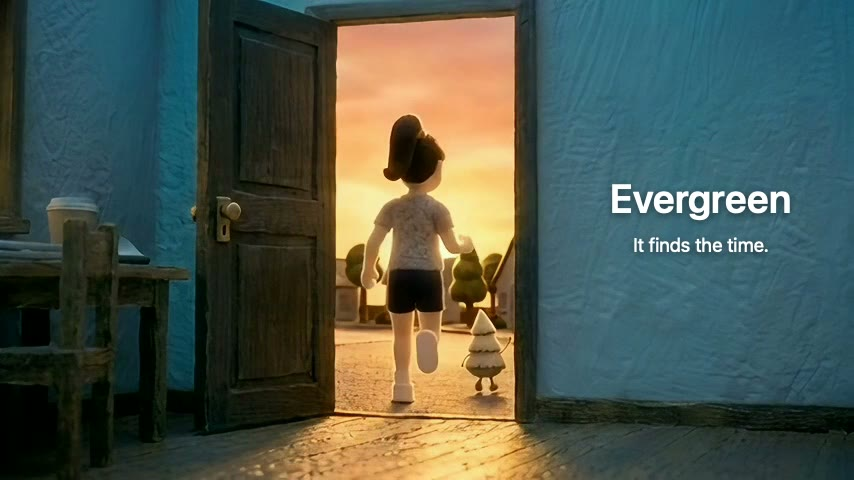

# Promo film: "It finds the time"

A 63-second film for Evergreen, told with the app's own tree as a felt puppet. One evening, in one continuous shot: she falls asleep over her laptop, the tree climbs out of her phone, shuts the laptop, pushes her running shoes to her feet, and she follows it out of the door into the sunset.

[Watch "It finds the time"](final/it-finds-the-time.mp4) (480p, with music).

A second film, "Don't give it back", a 30-second photoreal period short made with Kling 4.0, has its own folder: [`dont-give-it-back/`](dont-give-it-back/README.md).

## What is here

| Folder | Contents |
| --- | --- |
| [`final/`](final) | The finished film with music, the same film without sound, the music track, and the poster frame. |
| [`generated/pass-4-seven-segments/`](generated/pass-4-seven-segments) | The pass the film is cut from: seven video prompts, the 16 storyboard frames, reference images, the seven segments, rejected images and takes named by their fault, the unused music takes, and the scripts. |
| [`generated/pass-3-six-segments/`](generated/pass-3-six-segments) | The previous 60-second film, its six segments and prompts, the storyboards that led to it, and [the problems found in it](generated/pass-3-six-segments/problems-found.md). |
| [`generated/pass-2-single-take/`](generated/pass-2-single-take) | The whole film as one 30-second generation, with every prompt revision. It cut twice where a time range held too many actions. |
| [`generated/pass-1-eight-clips/`](generated/pass-1-eight-clips) | Eight separate clips joined together. It read as eight clips, not one evening. |
| [`generated/storyboard-before-filming/`](generated/storyboard-before-filming) | The five-shot storyboard drawn before any video was made. |
| [`generated/first-idea-discarded/`](generated/first-idea-discarded) | The first idea, "It listens", dropped because it made its point by mocking other apps. |

## How it was made

Images come from Gemini (`gemini-3-pro-image`), video from Seedance 2.5 at 480p, music from ElevenLabs Music. Video is generated without sound; the music is one track laid under the whole film.

| Segment | Length | Method | Input |
| --- | --- | --- | --- |
| 1 Push-in | 4 s | Image to video with a first and a last frame | `D_wide`, and the first frame of segment 2 |
| 2 At the desk | 17 s | Reference images to video | Tree, woman, size chart, `E_ots`, `E5_tree_out` |
| 3 Closing the laptop | 6 s | Extension of segment 2 | `E6_close_laptop` |
| 4 Pull-back | 5 s | Image to video with a first and a last frame | The last frame of segment 3, and `F_after_pull` |
| 5 Chair and shoes | 10 s | Extension of segment 4 | `G1`, `G2` |
| 6 Putting the shoes on | 10 s | Extension of segment 5 | `G3`, `G4`, `G5` |
| 7 Out of the door | 11 s | Extension of segment 6 | `H1`, `H2`, `H3`, the tree seen from behind |

## Make it again

You need an API key for FAL in `FAL_KEY` and one for Gemini in `GEMINI_API_KEY`, plus `ffmpeg`. The scripts are in `generated/pass-4-seven-segments/tools`.

1. Make an image: `python3 gen.py OUT.png "prompt" reference.png`. Add `IMAGE_SIZE=2K` in front for a 2K image.
2. Make a camera move between two images: `RES=480p DUR=4 AUDIO=0 python3 seed2.py OUT.mp4 prompt.txt first.png --end last.png`.
3. Make a segment from reference images: `RES=480p DUR=17 AUDIO=0 python3 seed2.py OUT.mp4 prompt.txt ref1.png --r2v --refs ref2.png ref3.png`.
4. Continue a segment: `TASK=extension RES=480p DUR=6 AUDIO=0 python3 seed2.py OUT.mp4 prompt.txt ref1.png --prev previous.mp4 --refs ref2.png`.
5. Name the seven segments `s1.mp4` to `s7.mp4`, then join them: `python3 assemble.py film.mp4` (needs `opencv-python-headless` and `numpy`).
6. Make the music: `python3 falrun.py fal-ai/elevenlabs/music ../music/music-request.json music.mp3`.
7. Put the first 63 seconds of the music under the film with `ffmpeg`.

## What made the models follow

- **A camera move needs a first and a last frame that agree.** If an object sits in a different place in the two images, the model slides it there or stretches the desk.
- **Make the wide frame by pulling back from the close frame.** Moving a small object inside a wide image failed three times; handing the close frame to the image model and asking for the wide view worked at once.
- **Change one thing per image edit**, list what must stay identical, and work at 2K. Give only a small detail crop as the second image; a whole scene leaks its other contents into the edit.
- **Few actions per segment.** Write the timeline in whole seconds, one action and one camera move per range.
- **State rules as "ALWAYS ..." sentences** rather than as prohibitions.
- **An extension starts about 6% tighter than the previous segment ends.** `assemble.py` eases the previous segment into that framing over its last 1.5 seconds.
- **Draw props at their true size in the first image.** Shoes drawn too big get shrunk when worn, or are left on the floor.
- **Turn the chair, then look.** A head turned 90 degrees on a body that faces the desk reads as wrong.
- **Check every segment before building on it**: frame-to-frame change values for cuts and jumps, then the list in `prompts/CHECKLIST.md`.

## Known faults in the film

- At 37 seconds the tree changes from a side view to a front view within one frame; a short dissolve softens it.
- The laptop closes in about 1.5 seconds, faster than written.
- In the push-in, the arc to the right happens mostly in the last second.
- There are no sound effects. Two ways of generating them were tried and neither was good enough to keep.
