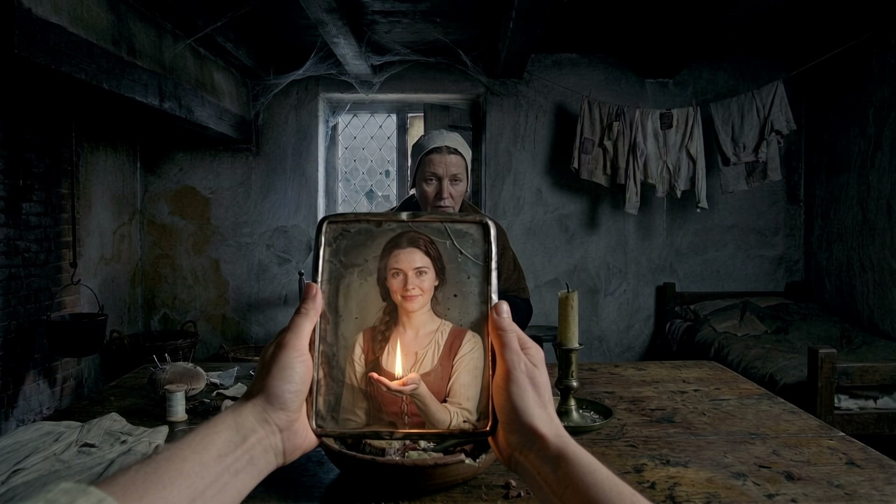

# Short film: "Don't give it back"

A 30-second photoreal period short, seen through the eyes of Wren, a young woman in a poor Dutch home around 1636. She cannot light a candle by magic. An old hand mirror shows her the same self holding a flame. When the church bell strikes three she hands the mirror to her mother and says "Don't give it back." She practises until dawn while her mother sleeps holding the mirror, and the candle catches.

The film has one idea: you get there by practising, not by looking at who you could be. It has no title card and no product shot.

[](final/dont-give-it-back.mp4)

[Watch "Don't give it back"](final/dont-give-it-back.mp4) (1080p, 30 seconds, with sound).

## What is here

| Folder | Contents |
| --- | --- |
| [`final/`](final) | The finished film and its poster frame. |
| [`prompts/`](prompts) | The prompt of the final take, and the prompts of three earlier approaches. |
| [`rough-cut/`](rough-cut) | The 720p rough cut made in four parts, and the prompt of each part. The final take was remade from it. |
| [`cast/`](cast) | Character sheets for Wren and the Mother: front, three-quarter, profile and waist-up. |
| [`frames/`](frames) | The room, the mirror, the props and the first-person keyframes; `frames/dark/` holds the same keyframes with the window light pulled down. |
| [`takes/`](takes) | Rejected takes at 480p, each named by its fault. |
| [`tools/`](tools) | Scripts for the images, the video request, the check and the grade. |

## How it was made

Images come from Gemini (`gemini-3-pro-image`). Video comes from Kling 4.0 (`kling/v4/reference-to-video` on fal), which generates picture and sound together, so the line and the room sound are not dubbed.

1. **Cast and props.** Four views of each character, the room, and an old hand mirror with one reflective side: a tortoiseshell back, as on period mirrors.
2. **First-person keyframes.** Five frames pin the story: the failed try, the mirror, the handover, dawn with the candle still dark, and the lit candle.
3. **Rough cut.** Four parts, each with its own first and last frame, joined end to end. Parts keep night as night and the candle dark until its frame, but the joins show.
4. **Final take.** The rough cut goes back in as `@Video1` with the first and last frames and both characters. The prompt asks Kling to keep its story and timing second by second, remake it as one continuous take, and change only named time windows: darker light, a clearer effort at the start, and the mother turning the mirror glass-in.
5. **Grade.** The take turns to day at 12 seconds, so `tools/grade.sh` pulls 12 to 20 seconds back to night and eases into dawn over 20 to 26 seconds.

## What each earlier approach got wrong

| Take | Approach | Fault | What changed |
| --- | --- | --- | --- |
| `third-person-candle-lit-early` | One 30-second prompt, third person | The candle lit in the first shot and the night looked like day. | Moved to first person, with a dark first frame and an unlit candle in it. |
| `first-person-turns-to-day-at-7s` | One 30-second prompt, first and last frame | The room jumped to the bright dawn of the last frame after 7 seconds; the bell beat was dropped. | Split into parts, each with its own first and last frame. |
| `three-parts-third-person-insert-at-25s` | Three 10-second parts | The last part cut to a close-up of Wren with her mother in a broken mirror. | Split the last part in two around a frame of dawn with the candle unlit; wrote "one continuous take". |
| `keyframes-crammed-into-first-8s` | One take with four middle keyframes | Kling placed all four keyframes in the first 8 seconds and spent the rest on one repeated gesture. | Middle keyframes take no timestamps, so the timed rough cut became the reference instead. |
| `remake-turns-to-day-at-12s` | The final take before the grade | Night became day at 12 seconds. | Graded back to night. |

What the final prompt follows:

- Say what should happen, not what should not; Krea's Kling 4.0 guide allows only "no subtitles" and "no background music" as negatives. The earlier prompts were full of "no" and "never" lines.
- Name one action per time window and say "one continuous take, no cuts".
- Put each prop in one size and one place in every frame; the model copies the frames, not the text.
- Keep the camera at her seated eyes; when an arm stretches across the table, say that only the forearm enters the frame, or her own head appears.

## Make it again

You need `python3` with Pillow, `ffmpeg` 7 or later, a FAL key in `FAL_KEY` and a Gemini key in `GEMINI_API_KEY`. Run from `marketing/dont-give-it-back`. Steps 1 to 3 replace the committed images in `cast/` and `frames/`; the video steps write to `out/`, which git ignores.

1. Make the character sheets, front view first:

   ```bash
   tools/cast.sh wren front
   tools/cast.sh wren threequarter
   ```

   Repeat for `profile` and `waist`, and for `mother`.

2. Make the plates and keyframes in this order, since later ones use earlier ones as references: `tools/frames.sh mirror`, then `props`, `room-night`, `table`, `start`, `mirror-key`, `end`, `handover`, `dawn-unlit`. The committed `start`, `mirror-key` and `end` were then corrected with single-change edits: the room darkened, a second mirror removed, and the mirror in the mother's hands resized.

3. Darken the window light, 0.8 for night frames and 1.0 for dawn:

   ```bash
   python3 tools/darken_window.py frames/start.png frames/dark/start.png 0.8
   ```

   Do the same for `mirror-key` and `handover` at 0.8, and `dawn-unlit` and `end` at 1.0. Then make the fist frame from the darkened start with `tools/frames.sh fist`; it was a middle keyframe in the `keyframes-crammed-into-first-8s` take.

4. The rough cut is included as `rough-cut/rough-cut.mp4`. Each of its four parts was one request with frames from `frames/`, not `frames/dark/`: `shared-rules.txt` appended to `part-1.txt` (frames `start` to `mirror-key`, 10 s), `part-2.txt` (`mirror-key` to `handover`, 10 s), `part-3a.txt` (`handover` to `dawn-unlit`, 6 s, with a free stock clip of a window brightening as `@Video1`) and `part-3b.txt` (`dawn-unlit` to `end`, 4 s, with a free stock clip of a wick catching).

5. Build the request for the final take and submit it:

   ```bash
   mkdir -p out
   python3 tools/request.py prompts/final-remake-from-rough-cut.txt out/request.json --start frames/dark/start.png --end frames/dark/end.png --video rough-cut/rough-cut.mp4
   python3 ../generated/pass-4-seven-segments/tools/falrun.py kling/v4/reference-to-video out/request.json out/take.mp4
   ```

   A 30-second 1080p take with a reference video costs about $8.50.

6. Grade it: `tools/grade.sh out/take.mp4 out/dont-give-it-back.mp4`.

7. Check it: `python3 tools/check.py out/dont-give-it-back.mp4 "Don't give it back."`, then look at a contact sheet at two frames a second:

   ```bash
   ffmpeg -i out/dont-give-it-back.mp4 -vf "fps=2,scale=320:-1,tile=5x3" out/sheet-%02d.png
   ```
